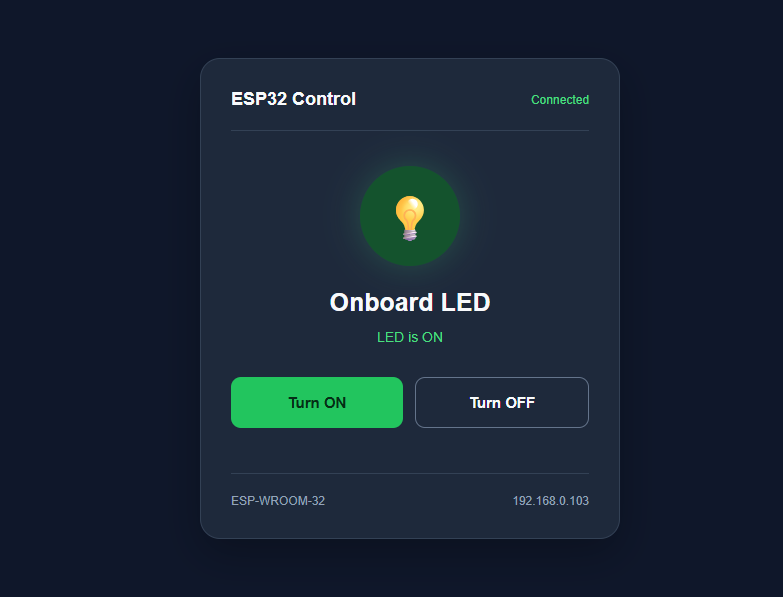

# ESP32 Web Control

A simple local web application hosted on an ESP-WROOM-32 microcontroller using the Arduino framework and PlatformIO.

The web interface allows users to turn the onboard LED ON/OFF and monitor its status in real time.

## Web Interface



## Features

- Local Wi-Fi web server
- LED ON/OFF control (GPIO2)
- Real-time LED status
- Responsive dark-mode interface
- No cloud or internet connection required

## Project Structure

```text
podFW/
├── platformio.ini
├── README.md
├── images/
│   └── esp32-web-control.png
└── src/
    ├── main.cpp
    └── webpage.h
```

## Requirements

- ESP-WROOM-32 development board
- VS Code with PlatformIO
- USB cable
- Local 2.4 GHz Wi-Fi network

## Getting Started

1. Open the project in VS Code.
2. Update Wi-Fi credentials in `src/main.cpp`.
3. Connect the ESP32 to your Windows PC via USB.
4. Click **Upload** in PlatformIO.
5. Open **Serial Monitor** at 115200 baud.
6. Find the ESP32 IP address.
7. Open the IP address in your browser.

Example:

http://192.168.0.101

## HTTP API

| Endpoint | Method | Description |
|---|---|---|
| `/` | GET | Web control interface |
| `/on` | POST | Turn LED ON |
| `/off` | POST | Turn LED OFF |
| `/status` | GET | Read LED status |

## Technology

- C++ / Arduino-ESP32
- HTML, CSS, JavaScript
- PlatformIO
- ESP32 Wi-Fi and WebServer libraries